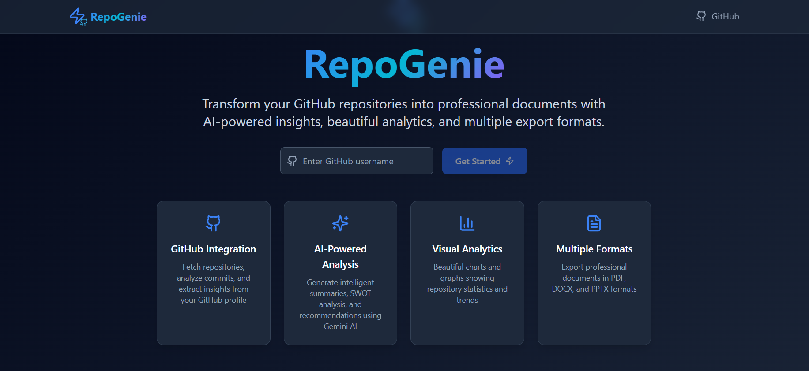
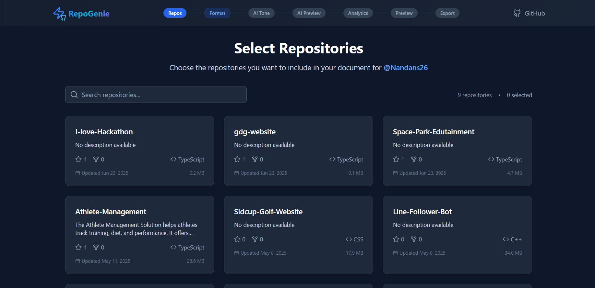
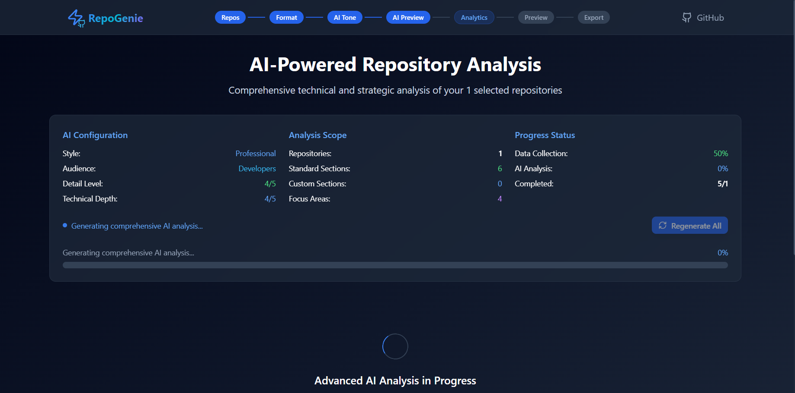

<h1 align="center">⚡ RepoGenie</h1>

<p align="center">
  <b>Turn your GitHub repositories into stunning, professional documents — powered by AI.</b><br/>
  🧠 Automate project reports · 📄 Export as PDF, DOCX, or PPTX · 🛠️ Built for Devs, Students & Teams
</p>

<p align="center">
  
  
  
  
</p>

---

## 🧠 What is RepoGenie?

**RepoGenie** is your personal AI-powered documentation wizard.

Whether you're:
- a **student** submitting a final-year project,
- a **developer** showcasing your GitHub work on your resume,
- or a **hackathon team** pitching your code to judges...

👉 RepoGenie automates the creation of stunning, customizable, and editable documents directly from your GitHub repositories.

### ✅ Features:
- 🔍 Fetches all your public GitHub repositories automatically
- ✅ Pick projects you want to include
- ✨ Auto-generates summaries, features, SWOT, and use-cases using a local **Ollama Phi-3 model**
- 💬 Choose a tone: Corporate, Geeky, Friendly, or Startup-style
- 📊 Adds stunning charts (commits, languages, stars, forks)
- 🎨 Choose from elegant design templates
- 🔎 Live preview and inline editing
- 📄 Exports to **PDF**, **DOCX**, and **PPTX**
- ⚡ All under 5 minutes!

---

## 🌐 Live Demo

👉 [Try RepoGenie Live →](https://repo-genie-9m6x.vercel.app/)

---

## 🧩 Tech Stack

| Layer        | Technology                              |
|-------------|------------------------------------------|
| Frontend     | React, Vite, TailwindCSS, Zustand        |
| Charts       | Recharts / Chart.js                     |
| Backend      | Firebase Functions (Optional)           |
| AI Integration | Ollama local HTTP API (Phi-3)         |
| GitHub Data  | GitHub REST API                         |
| PDF Export   | Puppeteer                               |
| DOCX Export  | docx (npm library)                      |
| PPTX Export  | PptxGenJS                               |
| Hosting      | Vercel + Git-based CI/CD                |

---

## 🚀 Getting Started (Run Locally)

### 1. 📦 Clone the Repo

```bash
git clone https://github.com/your-username/repogenie.git
cd repogenie
```

### 2. 📁 Install Dependencies

```bash
npm install
```

### 3. 🔐 Set Up Environment Variables

Create a `.env` file in the root folder and add:

```env
VITE_GITHUB_API_KEY=your_github_personal_access_token
VITE_OLLAMA_BASE_URL=http://localhost:11434
VITE_OLLAMA_MODEL=phi3:latest
VITE_USE_MOCK_AI=false
```

> The GitHub token is used only for GitHub API access. Ollama runs locally and does not require an LLM API key.
- [Create a GitHub token](https://github.com/settings/tokens)
- [Install Ollama](https://ollama.com/download)

### 4. 🧪 Run the App

```bash
npm run dev
```

Visit [http://localhost:3000](http://localhost:3000)

---

### 5. 🤖 Set Up the Local Phi-3 Model

RepoGenie sends repository-analysis prompts to your local Ollama server. No cloud LLM API key or paid LLM API is used.

```bash
ollama pull phi3:latest
ollama list
```

Keep Ollama running while using RepoGenie. The default API URL is `http://localhost:11434`; change `VITE_OLLAMA_BASE_URL` if your Ollama server uses another local URL. Set `VITE_OLLAMA_MODEL` to the exact tag shown by `ollama list`.

**Privacy boundary:** AI prompts and generated repository analysis go to the configured Ollama endpoint. With the default local URL, model inference runs on your machine. RepoGenie still contacts GitHub to fetch repository metadata and contents. Do not point the app at an untrusted Ollama endpoint.

**Troubleshooting:**
- If connection fails, start Ollama and run `ollama pull phi3:latest`.
- If the browser reports CORS, configure Ollama's `OLLAMA_ORIGINS` to allow the exact RepoGenie origin (for local Vite, `http://localhost:3000`) and restart Ollama.
- If generation times out or JSON is malformed, try fewer repositories per batch or a model with more available memory.
- Mock output is disabled by default. Set `VITE_USE_MOCK_AI=true` only when deliberately testing the UI without a running model.

## 🛠 Folder Structure

```
├── src/
│   ├── components/
│   ├── pages/
│   ├── services/
│   ├── store/
│   ├── utils/
├── public/
├── functions/
├── .env.example
├── vite.config.js
```

---

## ✨ Screenshots

|Input Page | Swlection Page | Generate Page |
|----------------|--------------|-------------|
|  |  |  |

---

## 💡 Use Cases

- 🧑‍🎓 Student Project Submission
- 💼 Resume & Developer Portfolio
- 🎯 Hackathon Final Deliverables
- 📊 Client Presentations for Freelancers
- 📂 OSS Contribution Documentation

---

## 📌 Future Enhancements

- 🔐 GitHub OAuth for private repo support
- 🌐 Export to live portfolio website
- 🧑‍🤝‍🧑 Team collaboration & roles
- ☁️ Upload to Google Drive / Share via URL
- 🧠 Local Ollama-powered Q&A assistant (planned)

---

## 🤝 Contributing

Contributions, feedback, and feature requests are welcome!  
Please feel free to submit Issues and Pull Requests.

---

## 🙌 Acknowledgements

- [GitHub REST API](https://docs.github.com/en/rest)
- [Ollama](https://ollama.com)
- [Tailwind CSS](https://tailwindcss.com)
- [PptxGenJS](https://gitbrent.github.io/PptxGenJS/)
- [html2pdf & Puppeteer](https://github.com/eKoopmans/html2pdf)

---

> 💬 _“Don’t just push code. Present it like a pro.”_ — **RepoGenie**
